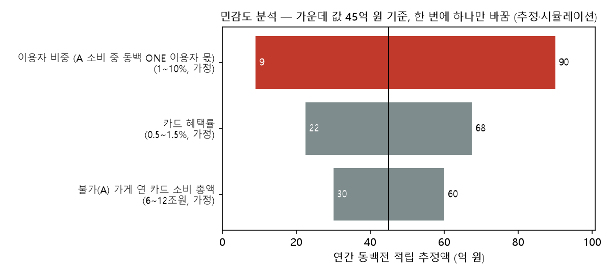

# STEP 3 재설계 — 동백전 적립 추정액

- 작성: 2026-10-20 / 상태: **초안 v2 (민감도 분석까지 진행)**
- 배경
  - 이전 판의 "불가 소비 연 15~26조 원"은 철회했어요([`worklog_2026-10-19.md`](worklog_2026-10-19.md) 인사이트 2).
  - 초안 v1은 "불가 소비를 더 정확히 구하자"에 집중했어요. 그런데 이 변수가 결과를 가장 **덜** 흔든다는 걸 알게 돼서 방향을 바꿨어요.
- 원칙
  - 결과는 **공공데이터 기반 추정·시뮬레이션**이에요.
  - 숫자마다 아래 네 가지 이름표 중 하나를 붙여요.
  - 기준 시점은 2026-06-30이에요.

| 이름표 | 뜻 | 예 |
|---|---|---|
| **사실** | 출처에 적힌 값 그대로 | 동백전 월 충전인원 41만 1,889명 (D10) |
| **가정** | 분석을 위해 정한 값 | 이용자 비중 5% |
| **추정** | 사실과 가정으로 계산한 값 | 적립 추정액 |
| **미확인** | 아직 모르는 것 | D1이 가게 위치 기준인지 사는 곳 기준인지 |

---

## 1. 우리가 도우려는 결정

| 누가 | 결정 | 필요한 숫자 |
|---|---|---|
| 기획 (이용자 관점) | 동백 ONE 적립이 이용자에게 쓸 만큼 매력이 있나? | **1인당 연 적립 추정액** |
| 은행 사업성 담당 | 적립 비용이 감당할 만한가? 혜택률을 얼마로 할까? | **연간 적립 총액** = 이용자 수 × 1인당 적립 |
| 정책 쪽 설명 | 동네 가게로 돌아오는 돈이 의미 있는 규모인가? | 적립 총액 ÷ 동백전 캐시백 예산(745억 원) |

> **⚠️ 결정 필요 (기획·은행 담당):** "1인당 월 적립 ○천 원 이상이면 매력 있음"처럼 **성공·실패 기준**을 먼저 정해 주세요. 기준이 있어야 시나리오 표를 "되나, 안 되나"로 읽을 수 있어요.

---

## 2. 문제 분해

```
1인당 연 적립 = 1인당 불가(A) 가게 연 카드 소비 × 카드 혜택률
연간 적립 총액 = 불가(A) 가게 연 카드 소비 총액 × 카드 혜택률 × 이용자 비중
```

- **1인당으로 먼저 계산해요.** 부산 전체 금액은 여기에 이용자 비중 시나리오를 곱하면 나와요.
- 1인당 소비는 사는 사람 기준이에요. 그래서 D1이 "사는 곳 기준"이어도 잘 맞아요. 담당관 답변이 없어도 막히지 않아요.
- 가정: 동백 ONE 이용자의 불가 가게 소비는 부산 15세 이상 평균과 같다고 봐요. 실제로 이용자는 평균보다 많이 쓸 수도 있어요.

### 가게 3단계 구분

| 단계 | 뜻 | 예 | 근거 |
|---|---|---|---|
| **A. 동백전 불가** | 결제 자체가 안 됨 (제한업소) | 대형 백화점·마트, SSM, 온라인, 타 지역 본사 직영점, 부산 밖 사업장 | D10 19쪽 |
| **B. 결제 가능·캐시백 0%** | 결제는 되지만 캐시백 없음 | 연매출 30억 원 초과 가맹점 | `ref/policy.csv`. D10 표3-16: 2022년 동백전 결제의 22.4% |
| **C. 결제·캐시백 가능** | 일반 가맹점 | 동네 가게 | |

> **⚠️ 결정 필요 (기획·BE 팀):** B 가게에서 동백 ONE이 동백전으로 결제하면 적립이 0이에요. 연결 카드로 결제하면 B도 적립 대상이 돼요. 지금 계산은 **A만** 넣었어요.

---

## 3. 가설

| 가설 | 확인 방법 | 상태 |
|---|---|---|
| H1. 결과를 가장 크게 흔드는 건 이용자 비중과 혜택률이고, 불가 소비 규모는 덜 흔든다 | 민감도 분석 (4절) | ✅ 확인 (4절) |
| H2. 1인당 적립이 이용자에게 의미 있는 수준이다 | 1인당 적립 vs 성공 기준 | 기준 정해지면 확인 |
| H3. 적립 총액이 동백전 캐시백 예산에 견줄 만하다 | 총액 ÷ 745억 원 | 4절 |

---

## 4. 민감도 분석 (1차, 2026-10-20)

- 입력값: [`ref/step3_inputs.csv`](../ref/step3_inputs.csv)
- 코드: `src/step3_sensitivity.py`
- 결과
  - `outputs/tables/02_sensitivity_tornado.csv`
  - `outputs/tables/02_credit_grid.csv`
  - `outputs/charts/02_tornado.png`

### 4-1. 결과

> 모든 값은 **추정**이에요. 입력값이 대부분 **가정**이라서, 숫자 자체보다 "어느 변수가 얼마나 흔드는지"를 보는 용도예요.

**① 무엇이 결과를 가장 크게 흔드나** (연간 적립 총액, 가운데 값 45억 원 기준, 변수를 한 번에 하나만 바꿈)



| 변수 | 범위 | 결과 | 흔드는 폭 |
|---|---|---|---|
| **이용자 비중** | 1~10% (가정) | 9 ~ 90억 원 | **10배** |
| 카드 혜택률 | 0.5~1.5% (가정) | 22.5 ~ 67.5억 원 | 3배 |
| 불가(A) 소비 총액 | 6~12조 원 (가정) | 30 ~ 60억 원 | 2배 |

→ **H1 확인.** 근거를 찾는 데 공을 들일 변수는 **이용자 비중**이에요. 불가 소비를 아무리 정확히 구해도 결과는 2배 안에서만 움직여요.

**② 연간 적립 총액 3×3** (억 원, A 소비 9조 원 고정)

| 혜택률 \ 이용자 비중 | 1% | 5% | 10% |
|---|---|---|---|
| 0.5% | 4.5 | 22.5 | 45.0 |
| 1.0% | 9.0 | **45.0** | 90.0 |
| 1.5% | 13.5 | 67.5 | 135.0 |

- 2024년 동백전 캐시백 예산(745억 원) 대비 **0.6~18.1%**예요.
- 가장 크게 잡아도 기존 캐시백 예산의 5분의 1 이하예요. → H3: **"캐시백 예산에 견줄 만한 규모"라고 말하기는 어려워요.**
- 표현을 바꾸는 게 좋겠어요. 예: "추가 예산 없이 동백전으로 들어오는 돈이 생긴다"

**③ 1인당 연 적립** (원, 이용자 비중과 무관)

| A 소비 \ 혜택률 | 0.5% | 1.0% | 1.5% |
|---|---|---|---|
| 6조 원 | 10,218 (월 851) | 20,436 (월 1,703) | 30,654 (월 2,554) |
| 9조 원 | 15,327 (월 1,277) | **30,654 (월 2,554)** | 45,981 (월 3,832) |
| 12조 원 | 20,436 (월 1,703) | 40,872 (월 3,406) | 61,308 (월 5,109) |

- 가운데 값 기준 **월 약 2,500원**이에요. 범위는 월 850~5,100원이에요.
- 비교 기준(사실): 2026년 1~6월 동백전 캐시백은 월 한도 50만 원 × 10% = **최대 월 5만 원**이에요(`ref/policy.csv`).
- → 동백 ONE 적립은 동백전 최대 캐시백의 **약 20분의 1** 수준이에요(추정). H2(이용자에게 매력 있는 수준)는 **성공 기준을 정해야 판단**할 수 있어요.
- 다만 이 값은 부산 15세 이상 **평균**이라는 가정이에요.
  - 실제로 카드를 많이 쓰는 사람이 동백 ONE을 쓴다면 1인당 적립은 더 커요.
  - "어떤 사람이 쓸까"는 이용자 비중과 같이 근거를 찾아야 할 부분이에요.

**이 결과가 제품에 주는 질문** (기획 팀 검토용)
- 1인당 월 수천 원의 적립이 "통합카드로 바꿀 이유"가 될까요?
- 만약 안 된다면, 혜택률을 높이는 것보다 **적립금 사용처(동네 가게 추가 혜택)**나 **편의성(카드 한 장)**을 핵심 가치로 내세우는 게 맞을 수 있어요.

---

## 5. 데이터를 모으는 순서 (민감도 분석 결과에 따라)

> 모든 데이터를 모으지 않아요. **결과를 크게 흔드는 변수부터** 근거를 찾아요.

| 우선 | 변수 | 지금 상태 | 근거를 얻는 방법 |
|---|---|---|---|
| 1 | **이용자 비중** | 가정 (1/5/10%), 근거 없음 | **대체 데이터:** 동백전 월 충전인원 41만 명(가입자의 25%), 설문 "동백전을 못 써서 대형마트를 안 갔다" 52.8%, 다른 지역 비슷한 서비스 이용률. **직접 만드는 데이터 (팀 결정):** 동백전 사용자 20~30명 짧은 설문 ("동백 ONE을 쓰겠나?", "대형마트·온라인에 월 얼마 쓰나?") |
| 2 | **카드 혜택률** | 가정 (지시서 0.5/1.0/1.5%) | 분석할 값이 아니라 **은행이 정하는 선택지**예요. 시나리오로만 보여 줘요 |
| 3 | 불가(A) 소비 총액 | 가정 (6/9/12조 원) | KOSIS "대형소매점 판매액" 부산 표 **하나만** 받아서 하한을 갱신해요. SSM, 온라인, 직영점은 범위 가정으로 두고 따로 파고들지 않아요 |
| 4 | D1 범위 | 미확인 | 담당관 전화 (비용이 적어서 해 둠). 1인당 계산에서는 결과를 막지 않아요 |

### 5-1. 이용자 비중 대체 데이터 (2026-10-20 조사)

동백 ONE과 닮은 서비스가 실제로 얼마나 쓰였는지 찾았어요. 분모는 부산 15세 이상 인구 293.6만 명(사실)이에요.

| 대체 데이터 | 값 (사실) | 15세 이상 대비 | 동백 ONE과 닮은 점 | 다른 점 |
|---|---|---|---|---|
| **동백패스** (2023-08 출시) | 2024년 말 61만 명 → 2025년 5월 말 70만 명 ([트윅24 2025-06-27](https://www.twig24.com/news/local_bs/2025/06/27/20250627500104)) | **20.8% → 23.8%** (출시 17~22개월) | 부산은행 **새 카드 발급**이 필요하고, 혜택이 **동백전으로 들어와요**. 가장 닮은 사례예요 | 혜택이 **월 최대 4만 5천 원**이에요. 동백 ONE 가운데 값(월 약 2,550원, 추정)의 약 18배예요. 대중교통 이용자만 대상이에요 |
| 동백전 월 충전인원 | 41만 1,889명 (2025-08, D10 18쪽) | **14.0%** | 이미 지역화폐를 "실제로 쓰는" 사람 수예요 | 캐시백이 7~13%로 커요 |
| 동백전 누적가입자 | 164만 명 (2025-08, D10 18쪽) | 55.9% | 한 번이라도 가입한 사람 | 가입만 하고 안 쓰는 사람이 4분의 3이에요 |
| 카드 포인트 → 지역화폐 전환 (NH포인트·코나아이) | 경기+인천 누적 **22.2억 원** ([SBS Biz 2026-07-02](https://biz.sbs.co.kr/amp/article/20000320255)) | 이용자 수 비공개 | 카드 혜택을 지역화폐로 바꾸는 구조가 **가장 비슷해요** | 직접 버튼을 눌러 바꿔야 해요. 동백 ONE은 자동이에요 |
| 설문 (D10 그림4-17) | 동백전 가입자의 52.8%가 "동백전을 못 써서 대형마트를 안 갔다" | — | 불가 가게에서 불편을 느끼는 사람이 많다는 신호예요 | 설문이라 실제 행동은 아니에요 |

**해석 (추정·가정)**
1. **위쪽 한계는 대략 14~24%예요.** 혜택이 훨씬 큰 동백패스와 동백전도 이 정도였어요. 동백 ONE의 1인당 혜택은 이들의 10~20분의 1이라서, 이 수준에 닿기는 어려워 보여요.
2. **혜택이 작고 손이 가는 서비스는 쓰는 사람이 적었어요.** 카드 포인트 전환은 경기·인천 두 큰 지역을 합쳐 몇 년 동안 22.2억 원이에요. 동백 ONE 가운데 시나리오(연 45억 원)의 절반이에요.
3. **동백 ONE의 장점은 "자동"이라는 점이에요.** 포인트 전환과 달리 이용자가 따로 할 일이 없어요. 그래서 포인트 전환보다는 많이 쓰일 수 있어요(가정).

**이용자 비중 범위에 대한 판단**
- **1~5%는 위 근거와 어긋나지 않아요.**
- **10%는 낙관적이에요.** 혜택이 18배 큰 동백패스의 40% 수준까지 가야 하기 때문이에요.
- 지시서 값(1/5/10%)은 그대로 두고, **10%는 "낙관" 시나리오로 이름을 붙여요.**

> **⚠️ 여전히 직접 근거는 없어요.** 위 자료는 모두 "비슷한 서비스"예요. 동백 ONE을 "쓰겠다"는 사람이 얼마인지는 **작은 설문**(동백전 사용자 20~30명)으로만 직접 확인할 수 있어요. 대표성은 없지만 방향은 알 수 있어요.

---

## 6. 결과가 말이 되는지 확인

| 점검 | 기준값 (사실) | 출처 |
|---|---|---|
| 적립 총액 ÷ 캐시백 예산 | 2024년 캐시백 예산 745억 원 | D10 표3-1 |
| 적립 총액 ÷ 발행액 | 2024년 발행 1조 3,440억 원 | D10 표3-1 |
| A 소비 총액 < 부산 카드 소비 | D1 2024년 40.9조 원 (범위 미확인) | D1 |
| A 소비 하한 ≥ 백화점+대형마트 | 2021년 5조 9,806억 원 (현금 포함) | 통계청 집계, 더팩트 2022-05-26 인용 |

---

## 7. 이후 할 일

| 순서 | 할 일 | 누가 |
|---|---|---|
| 1 | 성공·실패 기준 정하기 (1절), B 가게 결제 방식 정하기 (2절) | 기획·은행·BE |
| 2 | 이용자 비중 근거 찾기 (대체 데이터), 작은 설문 여부 결정 | Claude / 팀 |
| 3 | KOSIS 대형소매점 부산 표 받기 → A 하한 갱신 | Claude |
| 4 | 담당관 전화 | 사용자 |
| 5 | 최종 시나리오 표 → `outputs/tables/02_out_spend.csv`, `outputs/for_streamlit/region_return_scenarios.csv` | Claude |
